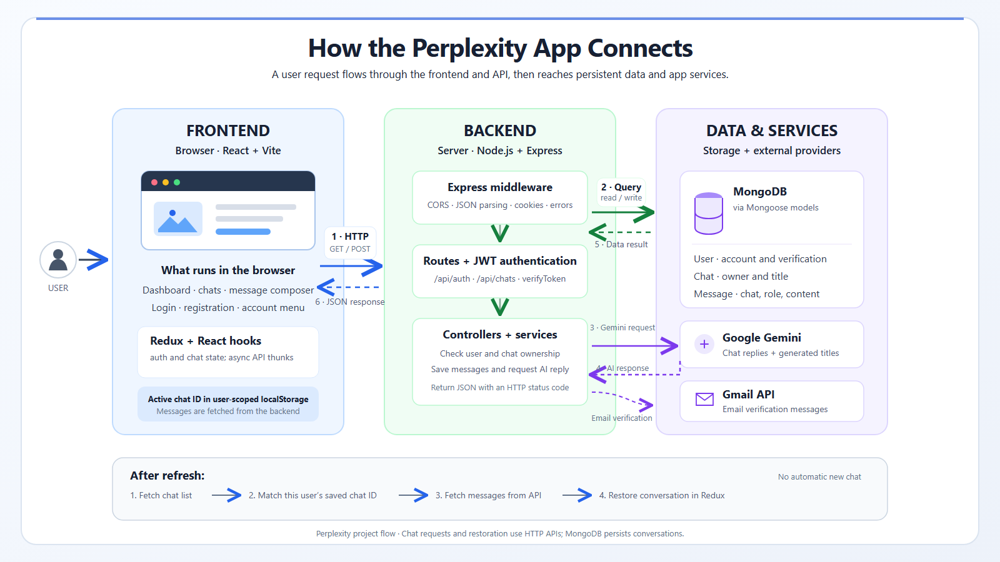

# Perplexity

An AI-powered chat application built with React, Express, MongoDB, and Google Gemini. Users can register and verify their accounts, send messages, and return to their saved conversations.

## Architecture



The React frontend communicates with the Express API over HTTP. The backend authenticates requests, persists users and conversations in MongoDB, and calls Google Gemini for chat responses. Gmail API is used to send account-verification emails.

## Features

- Account registration, login, email verification, and logout
- Cookie-based authentication and protected chat access
- AI-generated chat responses and conversation titles
- Persistent chats and messages stored in MongoDB
- Active conversation restoration after refresh
- User-scoped browser storage for the active chat ID
- Responsive chat interface, sidebar, and account menu

## Technology

| Area | Technologies |
| --- | --- |
| Frontend | React, Vite, React Router, Redux Toolkit, Axios, Tailwind CSS |
| Backend | Node.js, Express, JWT, bcrypt |
| Database | MongoDB, Mongoose |
| AI and email | Google Gemini, Gmail API |
| Web search integration | Tavily |

## Requirements

- Node.js and npm
- MongoDB, local or hosted
- A Google Gemini API key for AI responses
- Gmail API OAuth credentials to send verification emails
- A Tavily API key if using the internet-search integration

## Local setup

### 1. Configure the backend

Create `Backend/.env`:

```env
PORT=3000
NODE_ENV=development
MONGODB_URI=mongodb://127.0.0.1:27017/perplexity
JWT_SECRET=replace-with-a-long-random-secret
FRONTEND_URL=http://localhost:5173
BACKEND_URL=http://localhost:3000

GEMINI_API_KEY=your-gemini-api-key
TAVILY_API_KEY=your-tavily-api-key

GOOGLE_USER=your-verification-sender@gmail.com
GOOGLE_CLIENT_ID=your-google-oauth-client-id
GOOGLE_CLIENT_SECRET=your-google-oauth-client-secret
GOOGLE_REFRESH_TOKEN=your-google-oauth-refresh-token
```

Keep all real credentials private. Do not commit `.env` files. Set a strong, unique `JWT_SECRET`; do not rely on the development fallback. Gmail configuration is required for verification emails. The server logs a warning and continues to start if Gmail is not configured.

Install backend dependencies and start the API:

```bash
cd Backend
npm install
npm start
```

The API listens on port `3000` by default. MongoDB must be reachable before the backend starts.

### 2. Configure the frontend

Create `Frontend/.env`:

```env
VITE_API_URL=http://localhost:3000
```

Install frontend dependencies and start Vite in a second terminal:

```bash
cd Frontend
npm install
npm run dev
```

Open the local URL printed by Vite, typically `http://localhost:5173`.

## Available scripts

Run these commands from the corresponding `Frontend` or `Backend` directory.

| Directory | Command | Description |
| --- | --- | --- |
| `Frontend` | `npm run dev` | Start the Vite development server |
| `Frontend` | `npm run build` | Create a production frontend build in `dist/` |
| `Frontend` | `npm run preview` | Preview the production build locally |
| `Frontend` | `npm run lint` | Run ESLint |
| `Backend` | `npm start` | Start the Express API |
| `Backend` | `npm run dev` | Start the API through `npx nodemon` |

The backend package does not currently have an automated test suite configured.

## API overview

The backend mounts authentication routes at `/api/auth` and chat routes at `/api/chats`.

| Method | Endpoint | Purpose |
| --- | --- | --- |
| `POST` | `/api/auth/register` | Register an account |
| `POST` | `/api/auth/login` | Sign in |
| `POST` | `/api/auth/logout` | Sign out and clear the auth cookie |
| `GET` | `/api/auth/me` | Get the authenticated user |
| `GET` | `/api/auth/verify-email` | Verify an account using its email link |
| `POST` | `/api/auth/resend-verification` | Resend an account-verification email |
| `POST` | `/api/chats/send` | Send a message and receive an AI response |
| `GET` | `/api/chats` | List the authenticated user's chats |
| `GET` | `/api/chats/:chatId/messages` | Load messages for a chat |
| `DELETE` | `/api/chats/:chatId` | Delete a chat |
| `GET` | `/api/health` | Check whether the API is running |

Chat endpoints require authentication. The backend checks chat ownership before returning or deleting a conversation.

## Chat persistence

MongoDB stores users, chats, and messages as separate documents. Chats reference their owner, and messages reference their chat. Redux contains the data currently displayed in the browser; it is repopulated from the API after a refresh. The browser stores only the active chat ID, scoped to the signed-in user, and the frontend fetches that chat's messages from the backend. A refresh does not automatically create a new chat.

## Deployment notes

- Configure the environment variables in the hosting provider's secret/environment settings; never expose backend secrets to the frontend.
- Set `VITE_API_URL` to the deployed API origin when building the frontend.
- Set `FRONTEND_URL` to the exact deployed frontend origin so credentialed CORS requests are allowed.
- Use HTTPS in production; the authentication cookie's production settings require a secure connection.
- Use a hosted MongoDB connection string and a strong production `JWT_SECRET`.
- Configure `BACKEND_URL` to the public API origin used to construct email-verification links.
- Configure Gmail OAuth credentials and verify the sender account if email verification is required.

## Repository layout

```text
Backend/
  server.js
  src/
    Config/        Database connection
    controllers/   Authentication and chat handlers
    middleware/   Authentication middleware
    models/       Mongoose models
    routes/       Express API routes
    services/     AI, email, and search integrations
    validators/   Request validation
Frontend/
  src/
    app/           App bootstrap, routes, and Redux store
    features/      Authentication and chat features
    pages/         Shared pages
```
